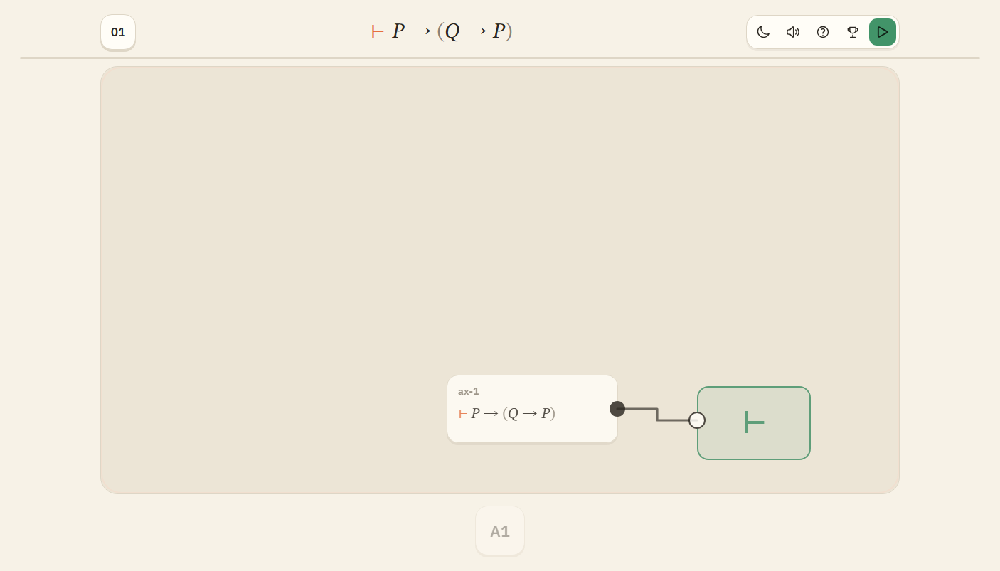

# 公理板

一个极简的模块化证明游戏。把公理、定义、代入、分离和量词规则接成一条线，让最终断言落到 `⊢` 上。

**在线玩：** https://yyxcnasd.github.io/RusselL/  
**仓库：** https://github.com/yyxcnasd/RusselL


## 怎么玩

- 点底部的大块元件，它会放到板上。
- 从模块右边的圆点拖到另一个模块左边的圆点。也可以先点输出、再点输入。
- 顶部是当前要证的断言。把它接到右侧 `⊢` 目标卡，然后点“校验”。
- 点左上角关卡数字选关。共 **240 关，分 4 个章节，每章 60 关**；每章再分**基础 30 关**与**挑战 30 关**。打通基础段就会解锁下一大章，挑战段不挡下一章。
- 点模块可换参数（原子字母、量词、代入项）；**右键模块/线删除**，触屏长按删除。
- 右上角 `◐` 切换深色模式，`♪` 开关音乐，`🏆` 查看成就；进度、每关最短推理长度、成就都会记在本地。

没有侧栏、没有教程段落、没有小字说明。第一次打开第一关时，板中央会出现 `A1 → ⊢` 的视觉提示。

| 接线 | 交板 | 选关 |
| --- | --- | --- |
|  |  |  |





## 内容来源：Metamath set.mm

这一版把内容来源从 PM Solitaire 的 `pmproofs` 换成了 **Metamath Proof Explorer（set.mm）**：

- 来源：<https://github.com/metamath/set.mm> 的 `develop` 分支，2026-11-07 下载到 `assets/data/set.mm`（51,812,832 字节）。
- 站点：[Metamath Proof Explorer](https://us.metamath.org/mpeuni/mmset.html)。
- 授权：set.mm 为 **CC0 / public domain**；页面文本为公有领域。
- 游戏运行时**不请求网络**；公式、公理、关卡数据全部在仓库里。

游戏只取 set.mm 的**原始语言**（¬、→、∀、=、∈），不引入类抽象 `{x | φ}`、⊆、∪ 等派生记法。

## 四章 · 240 关

| 章节 | 内容 | 关数 |
| --- | --- | --- |
| Ⅰ 命题 | set.mm 的 ax-1–ax-3、早期命题定理（∨/∧/↔ 用定义展开） | 60 |
| Ⅱ 谓词 | ax-4 / ax-5 / ax-10 / ax-11、全称推广与例化 | 60 |
| Ⅲ 等词 | ax-6 / ax-7 / ax-8 / ax-9 / ax-12 / ax-13 | 60 |
| Ⅳ 集合 | ZFC：ax-ext / ax-rep / ax-pow / ax-un / ax-reg / ax-inf / ax-ac | 60 |

每章前 9–12 关是手工设计的“概念关”；其余 48–51 关由 set.mm 档案自动生成，覆盖：

- **档案**：直接接一条 set.mm 公理/定理；
- **代入 / 双代入**：把图式原子换成复合公式；
- **全称闭包 / 例化**：把自由变元收回量词、再例化到常元；
- **分离**：把一条 set.mm 定理作为前件代入另一条定理再用 ax-mp。

set.mm 档案共 **829 条**（命题 570 / 谓词与等词 244 / 集合 15；定义不作为断言进入档案），
见 `src/archive.js`。

选关面板按 Ⅰ–Ⅳ 分组，每组显示自己的进度条。

### 公理（定义只作缩写）

命题演算（Łukasiewicz / Church P2）：

```
ax-1   P→(Q→P)
ax-2   (P→(Q→R))→((P→Q)→(P→R))
ax-3   (¬P→¬Q)→(Q→P)
ax-mp  A, A→B  ⊢  B          （游戏里的分离模块）
```

定义（**不是断言**，不能作为公理模块接进目标；只用于 `Logic.expand` 与 `replace` 双向置换）：

```
df-or   (P∨Q) ↔ (¬P→Q)
df-an   (P∧Q) ↔ ¬(P→¬Q)
dfbi2   (P↔Q) ↔ ((P→Q)∧(Q→P))      （set.mm 由 df-bi 导出）
df-ex   (∃x P) ↔ (¬∀x ¬P)
```

谓词与等词：

```
ax-gen  A ⊢ ∀x A                     （游戏里的全称推广模块）
ax-4    (∀x(P→Q))→((∀xP)→(∀xQ))
ax-5    P→∀xP                        x 不在 P 中自由
ax-6    ¬∀x¬x=y
ax-7    x=y→(x=z→y=z)
ax-8    x=y→(x∈z→y∈z)
ax-9    x=y→(z∈x→z∈y)
ax-10   ¬∀xP→∀x¬∀xP
ax-11   ∀x∀yP→∀y∀xP
ax-12   x=y→(∀yP→∀x(x=y→P))
ax-13   ¬x=y→(y=z→∀x y=z)
```

集合论七条 ZFC 公理见 `src/library.js` 与 `docs/set-theory.md`。

### 子章节、解锁、成就

- 每个大章分两段：**基础**（前 30 关，`◆`）与**挑战**（后 30 关，`★`）。
- 基础段内部顺序解锁；打通某章基础段最后一关，就解锁**下一大章的基础段**。
- 挑战段在基础段打通后解锁，内部顺序解锁；它不挡下一章。
- 选关面板每章显示两条独立进度条；当前所在段会自动滚动到视野内。
- 首次出现新规则（代入、分离、量词、档案、已证结论等）时，板子会**无文字演示**一遍参考电路；点一下可跳过。
- 每关记录**最短推理长度**（模块数），胜利面板与选关格上的小绿条会显示；成就系统记录基础段/挑战段、规则使用与“短证明”等条件。
- 成就与最短长度都存在本地；成就面板用图标网格展示，不写说明文字。

## 设计

- 一屏、单列：顶部目标，中间画布，底部元件条。
- 奶油纸色、黑色墨线、单一橙色强调；没有面板、没有状态栏、没有密集标签。
- 大公式、大圆点、大块元件；目标是 2048 那种“看一眼就知道点哪里”的直接操作。
- 中文回退系统字体；数字/标题 IBM Plex Sans；公式 STIX Two Text。
- 手机端：目标卡固定在可读范围，元件条横向滚动，模块宽度自动收窄。
- 指引尽量图形化：首次规则演示、带端口的元件块、选关段的 ◆/★、成就图标、推理长度小条；帮助页只保留公式级图示。

## 数学上的诚实说明

- **不重证 set.mm 的定理**：关卡里的目标是 set.mm 的公式；参考电路展示如何用前面的公理/结论把它接出来。游戏没有实现 set.mm 的完整证明器。
- **DV 条件**：ax-5 带有“x 不在 P 中自由”的限制（set.mm 的 `$d ph x`）。现行 set.mm 的
  ax-12 / ax-13 本身没有 `$d`；带 DV 的弱化版是 ax12v / ax13v。游戏把限制写在注记里，
  但引擎没有完整的 distinct-variable 检查；相关关卡只做安全实例。
- **wff 变元**：ax-rep 原式的 φ 是任意 wff；游戏里用原子 P 占位，属于简化。
- **集合论章**：以“公理即元件 + 变量闭包/例化”为主，不假装在游戏内重证 ZF 定理，也不引入类抽象。
- **定义置换**：`df-or`、`df-an`、`dfbi2`、`df-ex` 只在 `src/logic.js` 里参与“定义等价”判定与 `replace` 模块；它们不是关卡里可以接的断言。
- **引用结论**：`theorem:<关卡 id>` 只能引用**前面已经通关**的关卡；测试会强制这个顺序。

## 本地运行

直接打开 `index.html` 即可，或者：

```bash
python -m http.server 8000
```

然后访问 `http://localhost:8000`。

## 测试

```bash
npm test
# 17 个逻辑引擎测试 + 240 个参考电路校验（含章节平衡、定理依赖顺序、档案条目）
```

浏览器 smoke 测试（需要本机 Edge）：

```bash
node tests/simple-smoke.js
node tests/simple-ui.js
```

## GitHub Pages

- `https://yyxcnasd.github.io/RusselL/`
- `.github/workflows/pages.yml` 在每次推送 `main` 时运行 `node scripts/build-toy.js`，把 `dist/` 作为静态站点部署
- 页面全部使用相对路径，运行时无后端。

## bilibili Toy

```bash
node scripts/build-toy.js
```

把 `dist/` **里面的内容**压缩上传。构建只输出 bilibili Toy 白名单内的文件（`.html/.css/.js/.mp3/.woff2/.svg/.md`），没有 `.mjs`、`.txt`、`.pdf` 或开发文件。

## 声音、动效与布线

- **音乐**：YannZ 的 *lvl 3 – the grassland*（CC BY 4.0），循环播放；首次点击后开始，右上角扬声器图标可静音。
- **音效**：放模块、接线、失败、交板都有合成音；交板时触发彩色纸屑、目标焊盘脉冲、关卡数字弹跳与进度条增长。
- **布线**：16px 网格上的 A* 正交布线，带转弯惩罚、已有线段复用惩罚和节点障碍；优先绕开模块，尽量不叠线。
- **对齐/防重叠**：模块拖动与落点吸附 16px 网格，并让引脚中心落在网格上；重叠时自动寻找最近空位。
- **接口配色**：断言 = 墨色，公式 = 蓝色，原子 = 橙色；线色跟随源端口类型；断言模块的输出带橙色 `⊢`。
- **深色模式**：整套颜色变量切换，偏好持久化。

## 文件

```
index.html               单屏游戏
src/simple.css           极简视觉
src/board.js             画布、模块、焊盘、铜线
src/main.js              关卡流程、元件条、参数、选关
src/library.js           set.mm 公理/定义/调色板
src/archive.js           set.mm 档案条目（829 条，生成）
src/levels.js            四章手工关（命题 9，其余 12）
src/levels-generated.js  四章其余关卡（生成，共 195 关）
src/logic.js             公式 AST / 解析 / 展开 / 代入 / 置换 / 分离
src/engine.js            模块求值器
scripts/build-toy.js     静态构建
scripts/gen-levels.js    关卡/档案生成器
scripts/prove.js         命题证明搜索器（开发工具，不参与构建）
assets/data/set.mm       Metamath set.mm 数据源（开发参考，不参与构建）
assets/fonts/            本地字体（OFL）
assets/audio/            CC BY 4.0 背景音乐
dist/                    Toy / Pages 静态构建
docs/                    数学与数据说明
research/                set.mm 提取数据与说明（不参与构建）
screenshots/             README 截图
tests/                   逻辑与关卡测试
```

## 来源

- 背景音乐：**lvl 3 – the grassland** by **YannZ**，来自 [OpenGameArt](https://opengameart.org/content/indie-meditations-free-music-pack)，**CC BY 4.0**；署名见 [CREDITS.md](CREDITS.md)。
- **Metamath set.mm**：<https://github.com/metamath/set.mm>（CC0 / public domain）。
- 《数学原理》（Whitehead & Russell, 1910–1913）为公有领域；本作不再使用 `pmproofs` 档案作为内容来源。
- IBM Plex Sans / STIX Two Text 为 SIL Open Font License。
- 本作不是 Metamath 官方产品。
