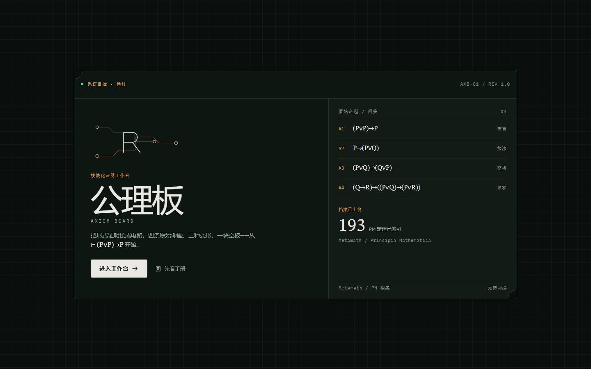
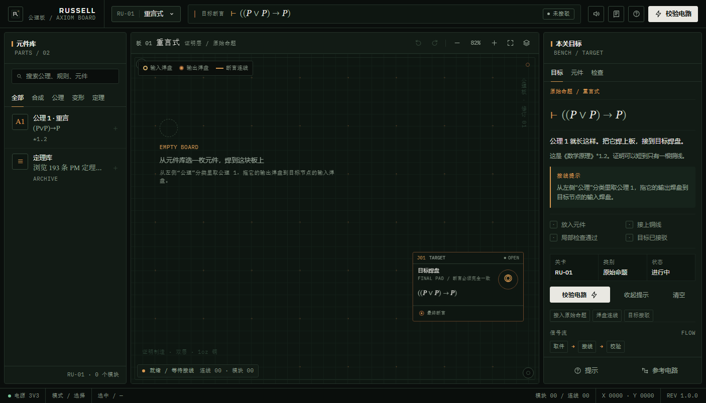
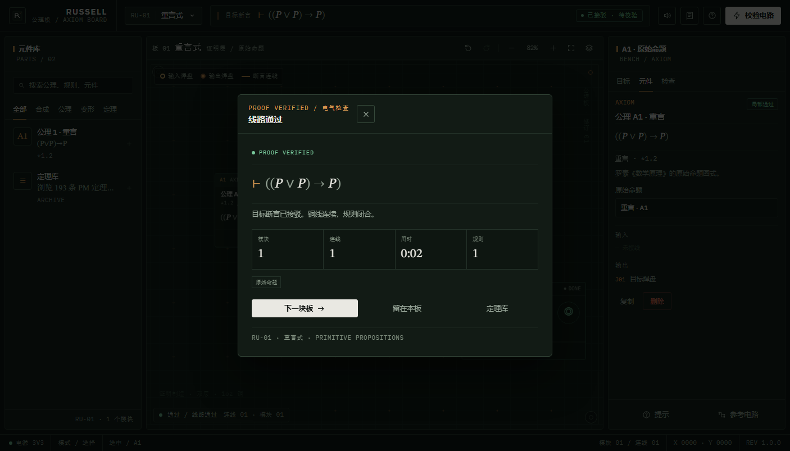
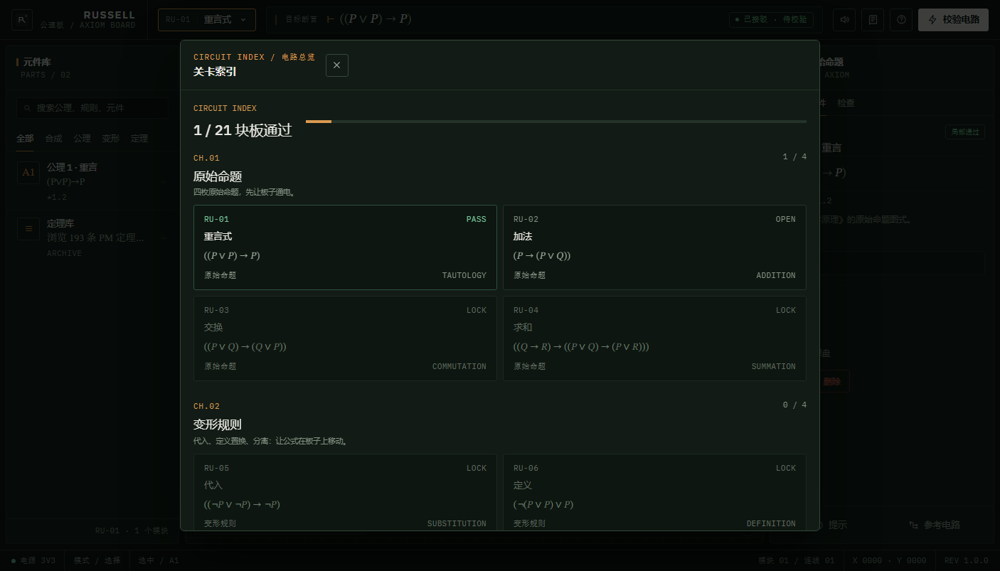
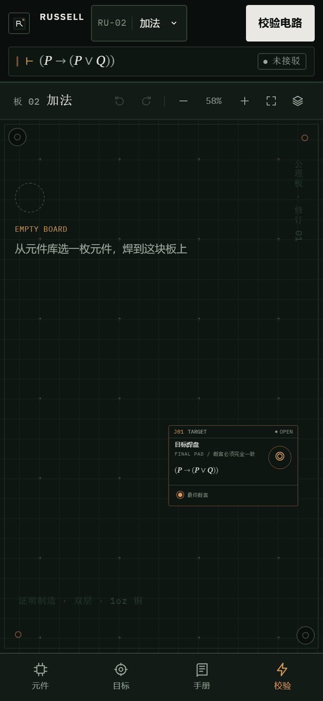

# 公理板 / AXIOM BOARD

把形式证明接成电路。一个静态、离线优先的模块化证明工作台，以罗素与怀特海《数学原理》的命题演算为蓝本，视觉语言取自印刷电路板：暗色阻焊层、铜走线、金色焊盘、丝印标签。

打开 `index.html` 即可游玩，无需构建、无需联网。



| 工作台 | 交板 |
| --- | --- |
|  |  |

| 关卡索引 | Metamath Atlas | 手机 |
| --- | --- | --- |
|  |  |  |

## 它是什么

- 每个关卡是一条断言（定理图式），例如 `⊢ ¬¬P→P`、`⊢ (P∨Q)→(Q∨P)`。
- 玩家从元件库取出公理、原子、合成门与变形模块，用铜线把它们接起来。
- 每个模块只执行一条规则：代入、分离、定义置换，或谓词层的例化/推广/存在规则。
- 最终断言接到右侧目标焊盘，点击“校验电路”。所有模块局部通过、最终断言与目标定义等价，才算交板。
- 21 个可玩关卡：15 个命题演算关卡 + 5 个谓词演算关卡 + 1 个档案沙盒（全部 193 条定理自由接入）。
- 完整接入 Metamath Solitaire 记录的 **193 条《数学原理》命题演算定理**，可检索、查看公式与“证明带”。

## 操作

| 操作 | 说明 |
| --- | --- |
| 点击元件库 | 在当前视野空位放下一枚模块 |
| 点击模块 | 右侧检查器显示输出、配置、局部状态 |
| 从输出焊盘拖到输入焊盘 | 接一根铜线；输出可扇出，输入只接一根 |
| 先点输出、再点输入 | 触屏/无障碍的接线方式（也适合精确点选） |
| 拖动空白 / 滚轮 | 平移 / 缩放画布 |
| `F` / 适应按钮 | 框住全部模块 |
| `Ctrl+Z` / `Ctrl+Y` | 撤销 / 重做 |
| `Delete` | 删除选中的模块或连线 |
| 双击模块 | 聚焦该模块 |
| 顶栏关卡名 | 打开关卡索引 |
| 顶栏书本 | 打开手册、规则与 193 条定理库 |

在手机上，底部工具栏提供“元件 / 目标 / 手册 / 校验”；面板以底部抽屉出现。画布支持单指拖动与双指/滚轮缩放。

## 数学边界（重要）

本作的**第一章严格只有截图中的四条初始公理**：

```
A1  (P∨P)→P
A2  P→(P∨Q)
A3  (P∨Q)→(Q∨P)
A4  (Q→R)→((P∨Q)→(P∨R))
```

定义 D1–D3：

```
D1  A→B  := ¬A∨B
D2  A∧B  := ¬(¬A∨¬B)
D3  A↔B  := (A→B)∧(B→A)
```

这四条公理不足以从零推出全部经典命题演算定理；《数学原理》本身还有 `*1.6` 结合律等原始命题。因此本作把它们之后的定理明确标成**档案定理 / 引用定理**，作为封装模块接入，而不是假装它们是本作四条公理的自然推论。`*2.14` 等档案定理的编号、步数与证明带来自 Metamath Solitaire 的 PM 记录；其证明基于该 applet 的公理基（`ax-1`、`ax-2`、`ax-3`、`ax-mp`），与本作四条公理不是同一形式系统。

谓词层同样区分原始图式、定义与档案结果；对无法直接核到的 PM 编号，页面写“参《数学原理》相应章节”，不编造编号。

## Metamath 档案

Metamath 的 PM 命题演算记录是完整的 193 条：

- 来源：[us.metamath.org/mmsolitaire/pmproofs-orig.txt](https://us.metamath.org/mmsolitaire/pmproofs-orig.txt)
- 数据文件：`assets/data/pm-proofs.md`（保留原始下载，文件名改为 Toy 允许的扩展名）
- 运行时数据：`src/theorems.js`（`window.RSL.THEOREMS`，193 条，0 重复）
- 解析/来源说明：`docs/metamath.md`
- 定理库 UI 中每条可查看：PM 编号、名称（有则显示）、Unicode 公式、步数、压缩分离证明带
- “Metamath”页签另含 Atlas：Proof Explorer（ZFC，40,000+）、Intuitionistic Logic Explorer、New Foundations Explorer、Higher-Order Logic Explorer、Metamath Solitaire、Other Topics / Milpgame / XPuzzle

运行时**不请求任何网络地址**；Atlas 卡片只是外链。

## 文件

```
index.html                 应用外壳
src/logic.js               命题 + 谓词公式 AST、解析、展开、代入、置换、分离、匹配
src/engine.js              模块元数据与图求值器
src/graph.js               PCB 画布：模块、焊盘、铜线、拖拽、缩放、撤销
src/library.js             四条公理、定义、元件库
src/levels.js              15 个命题关卡、档案沙盒与参考电路
src/predicate.js           谓词层公理、规则、5 个关卡
src/theorems.js            193 条 PM 定理索引
src/metamath.js            Metamath Atlas 与证明带 tokenizer
src/app.js                 关卡流程、检查器、手册、定理库
src/styles.css             视觉系统
src/overrides.css          应用集成层（启动舱、模块引脚、检查器、抽屉等）
design/preview.html        视觉系统静态预览
assets/fonts/              本地字体（IBM Plex / STIX Two，OFL）
assets/data/pm-proofs.md   Metamath 原始记录
docs/                      接口契约、谓词与 Metamath 说明
tests/                     逻辑、关卡电路与浏览器 smoke 测试
scripts/build-toy.js       构建 bilibili Toy 兼容目录
```

## 开发与验证

```bash
# 逻辑引擎单元测试（17 项）
node --test tests/logic.test.mjs

# 全部 21 个参考电路必须在真实 engine 上完成
node tests/levels.test.js

# 构建 bilibili Toy 兼容目录（白名单审计）
node scripts/build-toy.js
```

浏览器 smoke / 视觉检查脚本在 `tests/cdp-*.js`，使用本机 Edge 的 CDP；它们不是运行时依赖。

## bilibili Toy

```bash
node scripts/build-toy.js
```

构建后的 `dist/` 只包含 bilibili Toy 白名单内的扩展名（`.html/.css/.js/.woff2/.svg/.md` 等），没有任何 `.mjs`、`.txt`、`.pdf` 或开发文件。

发布时把 `dist/` **里面的内容**压缩上传，而不是把 `dist` 文件夹本身作为一层。运行时不需要网络；平台 SDK 不是必需依赖，`window.toy` 不存在时自动退化到普通浏览器。进度使用 `localStorage`，若容器禁用存储则使用内存回退。

## 来源与许可

- 《数学原理》（Whitehead & Russell, 1910–1913）文本已进入公有领域。
- Metamath Solitaire 的 PM 定理记录来自 [us.metamath.org](https://us.metamath.org/)，站点文本为公有领域；本作只保存定理陈述、编号、步数和压缩证明带。
- IBM Plex Sans / IBM Plex Mono / STIX Two Text 为 SIL Open Font License 字体，文件已本地打包。
- 本作不是 Metamath 官方产品；档案编号与来源以 Metamath 记录为准。

## 设计

工业极简 / PCB：暗色阻焊层地面、1px 丝印线、铜色作为唯一强调色、焊盘与青色走线、等宽字体只用于参考编号和引脚元数据。视觉方向来自 `data-terminal` app style（seed `994157066`），调色板按 PCB 材料重绘；详细偏离记录在构建报告与 `docs/CONTRACT.md` 中。


