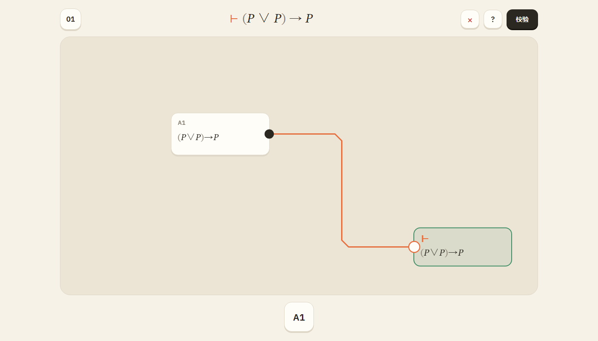
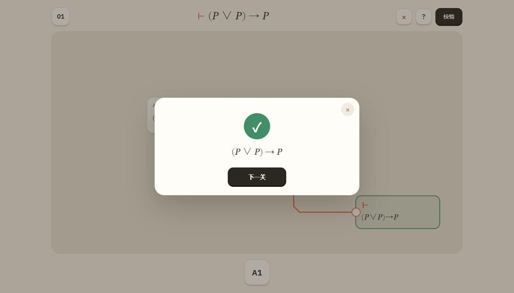

# 公理板

一个极简的模块化证明游戏。把公理、代入、分离和定义置换接成一条线，让最终断言落到 `⊢` 上。

**在线玩：** https://yyxcnasd.github.io/RusselL/  
**仓库：** https://github.com/yyxcnasd/RusselL


## 怎么玩

- 点底部的大块元件，它会放到板上。
- 从模块右边的圆点拖到另一个模块左边的圆点。也可以先点输出、再点输入。
- 顶部是当前要证的断言。把它接到右侧 `⊢` 目标卡，然后点“校验”。
- 点左上角关卡数字选关。共 40 关，全部开放。
- 点模块可换参数（原子字母、量词、定义置换）；点顶部 `×` 删除选中的模块或线。

没有侧栏、没有教程段落、没有小字说明。第一次打开第一关时，板中央会出现 `A1 → ⊢` 的视觉提示。

| 接线 | 交板 | 选关 |
| --- | --- | --- |
|  |  |  |

## 40 个关卡

- **15 个命题演算核心关**：四条罗素原始命题、代入、定义置换、分离、双重否定、合取消去、德摩根。
- **20 个 Metamath 题库关**：直接取自 Metamath Solitaire 记录的《数学原理》命题编号与公式，例如 `*2.1`、`*2.15`、`*3.1`、`*4.4`、`*4.41`。
- **5 个谓词演算关**：全称例化、存在引入、全称推广、量词分配、`∃` 定义桥。

初始公理只有四条：

```
A1  (P∨P)→P
A2  P→(P∨Q)
A3  (P∨Q)→(Q∨P)
A4  (Q→R)→((P∨Q)→(P∨R))
```

定义：

```
D1  A→B  := ¬A∨B
D2  A∧B  := ¬(¬A∨¬B)
D3  A↔B  := (A→B)∧(B→A)
```

三条变形规则：代入、分离、定义置换。

数学上必须诚实：这四条公理本身不足以从零推出全部经典命题演算。《数学原理》还有 `*1.6` 等原始命题，因此 `*2.1` 之后的关卡明确使用**档案定理模块**，而不是假装它们由四条公理直接推出。`*2.14` 等编号、步数和压缩证明带来自 Metamath 的 PM 记录，其证明基于另一组公理基。

## Metamath

- 来源：[pmproofs-orig.txt](https://us.metamath.org/mmsolitaire/pmproofs-orig.txt)
- 193 条 PM 定理索引在 `src/theorems.js`，包含编号、公式、步数和证明带
- 20 个 PM 题库关从这 193 条中选取
- 详细说明：[docs/metamath.md](docs/metamath.md)
- 运行时**不请求网络**，所有字体和数据都在仓库里

## 设计

- 一屏、单列：顶部目标，中间画布，底部元件条。
- 奶油纸色、黑色墨线、单一橙色强调；没有面板、没有状态栏、没有密集标签。
- 大公式、大圆点、大块元件；目标是 2048 那种“看一眼就知道点哪里”的直接操作。
- 中文回退系统字体；数字/标题 IBM Plex Sans；公式 STIX Two Text。
- 手机端：目标卡固定在可读范围，元件条横向滚动，模块宽度自动收窄。

## 本地运行

直接打开 `index.html` 即可，或者：

```bash
python -m http.server 8000
```

然后访问 `http://localhost:8000`。

## 测试

```bash
npm test
# 17 个逻辑引擎测试 + 40 个参考电路校验
```

浏览器 smoke 测试（需要本机 Edge）：

```bash
node tests/simple-smoke.js
node tests/simple-ui.js
```

## GitHub Pages

Pages 从 `main` 分支根目录发布：

- `https://yyxcnasd.github.io/RusselL/`
- `.nojekyll` 已加入，页面使用相对路径
- 推送 `main` 后 GitHub Pages 会自动重建

## bilibili Toy

```bash
node scripts/build-toy.js
```

把 `dist/` **里面的内容**压缩上传。构建只输出 bilibili Toy 白名单内的文件（`.html/.css/.js/.woff2/.svg/.md`），没有 `.mjs`、`.txt`、`.pdf` 或开发文件。

## 文件

```
index.html               单屏游戏
src/simple.css           极简视觉
src/board.js             画布、模块、焊盘、铜线
src/main.js              关卡流程、元件条、参数、选关
src/logic.js             公式 AST / 解析 / 展开 / 代入 / 置换 / 分离
src/engine.js            模块求值器
src/levels.js            40 个关卡与参考电路
src/predicate.js         谓词层
src/theorems.js          193 条 PM 定理数据
src/metamath.js          Metamath 数据与证明带
assets/fonts/            本地字体（OFL）
dist/                    Toy / Pages 静态构建
docs/                    数学与数据说明
screenshots/             README 截图
tests/                   逻辑与浏览器测试
```

## 来源

- 《数学原理》（Whitehead & Russell, 1910–1913）为公有领域。
- Metamath 的 PM 定理记录来自 [us.metamath.org](https://us.metamath.org/)；站点文本为公有领域。
- IBM Plex Sans / STIX Two Text 为 SIL Open Font License。
- 本作不是 Metamath 官方产品。
