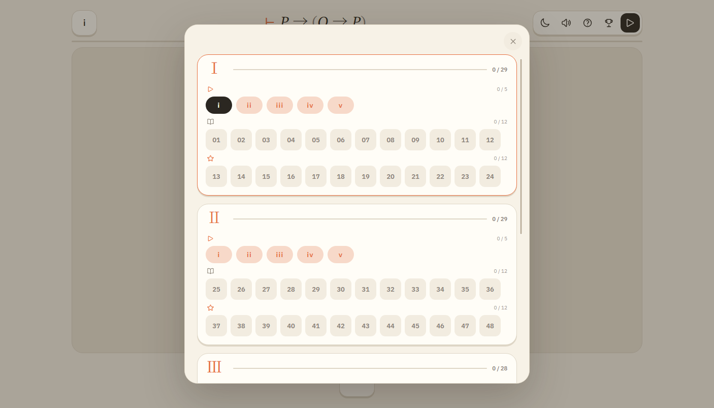
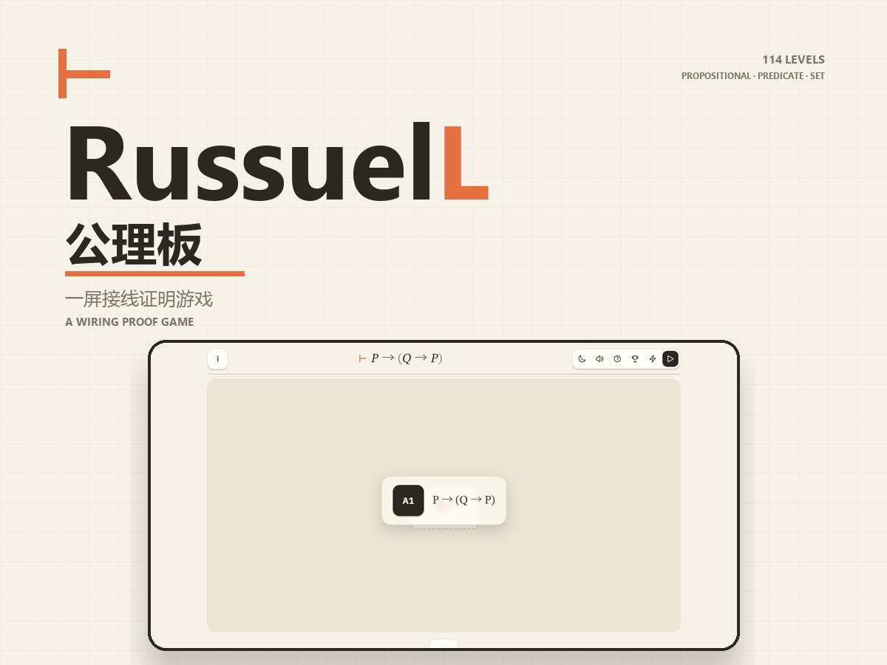
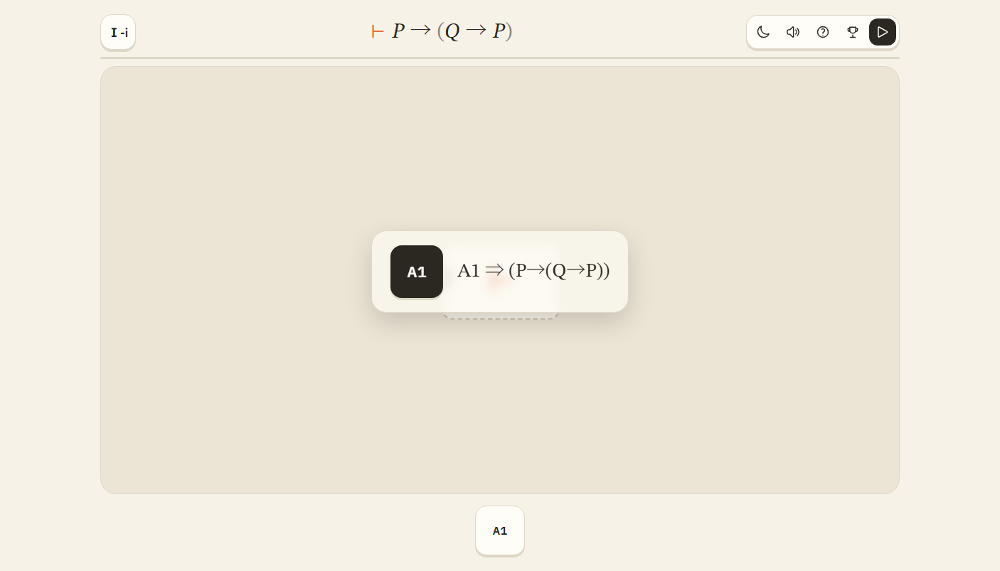

<div align="center">
  
  <h1>RussuelL · 公理板</h1>
  <p><b>把形式证明，接成一块板。</b></p>
  <p>一款基于 Metamath <code>set.mm</code> 的接线证明游戏。<br>
     每关给你一块空板、几枚公理或规则模块，以及一个要证的断言。</p>

  <p>
    <a href="https://github.com/yyxcnasd/RusselL"></a>
    <a href="https://yyxcnasd.github.io/RusselL/"></a>
    
    
    
    
  </p>

  <p>
    <a href="#两个版本">两个版本</a> ·
    <a href="#怎么玩">怎么玩</a> ·
    <a href="#提示">提示</a> ·
    <a href="#排行榜">排行榜</a> ·
    <a href="#关卡结构">关卡结构</a> ·
    <a href="#演算与元件">演算与元件</a> ·
    <a href="#成就存档与进度">成就与存档</a> ·
    <a href="#本地运行">本地运行</a> ·
    <a href="#开发">开发</a> ·
    <a href="#致谢">致谢</a>
  </p>
</div>

<p align="center">
  
</p>

## 两个版本

**GitHub Pages** 是网页版：[yyxcnasd.github.io/RusselL](https://yyxcnasd.github.io/RusselL/)。打开就能玩，存档留在浏览器本地，也可以从帮助页导出/导入 JSON。

**Bilibili Toy** 是站内版，slug 为 `RusselL`。关卡、规则和成绩与网页版一致；Toy 版把存档自动写到当前 B 站账号的云存储，帮助页不再显示上传/下载按钮。提示功能需要关注 UP 主，详见下一节。上线地址是 `https://www.bilibili.com/toy/RusselL/index.html`（审核通过后可用）。

<p align="center">
  
</p>

## 怎么玩

1. **拿模块**：从下栏把模块拖到板上。也可以点一下模块，再点画布放下。
2. **接线**：从模块右侧圆点拖到另一个模块左侧圆点；先点输出、再点输入也可以。
3. **校验**：把最终断言接到右侧的 `⊢`，点顶栏最右边的播放键。

右键删除模块或导线；把模块拖回下边栏也能删。已接线的输入端可以按住拖走拆线，拖到别的输入端重接。触屏支持双指缩放，双击空板回到适应视图。卡住时也可以看 [docs/SOLUTIONS.md](docs/SOLUTIONS.md)：159 关逐关列出参考电路的模块与接线。

框选多个模块后，直接拖其中任意一个就能整体移动，不用再按 Shift。`Ctrl/Cmd+C` 复制选中模块和它们之间的线，`Ctrl/Cmd+V` 粘贴成跟随鼠标的磁吸贴；左键放下。目标位置放不下时会留在鼠标上，不会把模块挪到别处。跨关粘贴只保留当前关允许使用的元件。

同一类的构造元件只占一个下栏格子：原子、个体、谓词、`∀`、`∃` 都是放下来之后再从弹层里选具体取值。弹层给的是完整取值集合，不会因为本关参考证明只用了 P/Q/R 就只显示这三个。

## 提示

顶栏灯泡打开三页提示，可左右翻页：

1. **方向**：自动解锁，一句话说明往哪想。
2. **思路**：点赞视频 [BV1pk4J68Egx](https://www.bilibili.com/video/BV1pk4J68Egx) 后解锁，说明大致构造。
3. **接线**：关注 UP 主「夜与星尘_NaSd」后解锁，列出参考解的模块与接线。

Toy 预览页和作者本人直接看三页。GitHub Pages / 本地不显示提示按钮。

## 排行榜

B 站 Toy 版有排行榜入口，和帮助、提示按钮并排在顶栏。GitHub Pages / 本地没有 Toy 的登录态，不显示这个入口。

分数把「通过关数」放在第一关键字：`通关数 × 100000 + 效率分`。效率分按参考解的模块数加权统计，每关取 `min(1, 参考模块数 / 你的模块数)`，再乘以该关参考模块数求和，最后归一化到 0–99000。你用的模块越少，效率分越高；优于参考解也只计满。这样同样通关数下继续比模块效率，而多通过一关永远优先于任何效率差距。

通关时自动提交成绩；榜单显示前 20 名和我的名次。排行榜数据由 Toy 平台按账号保存，换设备登录同一账号也能看到。

## 关卡结构

共 159 关：四章各 **10 个普通关 + 24 个困难关**，外加 23 个教学关。每章从 `01` 重新编号，关卡号写作 `Ⅰ-01`、`Ⅱ-07`；定理模块也直接用这个编号引用更早关卡。

| 章 | 主题 | 教学 | 普通 | 困难 |
|:---:| --- |:---:|:---:|:---:|
| Ⅰ | 命题演算：A1–A3、代入、分离 | i–x | Ⅰ-01–Ⅰ-10 | Ⅰ-11–Ⅰ-34 |
| Ⅱ | 谓词与量词：全称/存在规则、A5 | i–v | Ⅱ-01–Ⅱ-10 | Ⅱ-11–Ⅱ-34 |
| Ⅲ | 等词：等词自反、Leibniz 替换 | i–iv | Ⅲ-01–Ⅲ-10 | Ⅲ-11–Ⅲ-34 |
| Ⅳ | 集合论：∈、外延/空集/配对/并集 | i–iv | Ⅳ-01–Ⅳ-10 | Ⅳ-11–Ⅳ-34 |

普通关的参考解控制在 **5–20 个元件**；困难关可以很大，并允许引用前面的普通关引理。教学关和普通关有一对一定制提示，困难关不提供提示。

教学关每关只演示一个元件，参考证明大多一步直连，最长 12 步。进入教学关时，棋盘正中会出现一张浮窗，左边是本关元件的代号，右边是规则式（例如 `A1` 与 `P→(Q→P)`）；点一下棋盘就收起。

<p align="center">
  
</p>

## 演算与元件

游戏只用一套演算：经典 `<script>`、无构建步骤、运行时不发网络请求。

| 类别 | 模块 |
| --- | --- |
| 构造 | 命题原子 `P…V`，个体变元 `x…w`，谓词/等词 `F(x)`/`x=y`，属于 `x∈y`，`¬`、`→`、`∀x`、`∃x`、`∧∨↔` |
| 公理 | A1–A5（命题公理、全称消去、全称分配）；集合论：外延、空集、配对、并集 |
| 基本推理 | 代入、分离、全称推广/引入/例化、存在推广/消去、等词自反、Leibniz 等词替换，以及 ∧/∨/↔ 的引入/消去公理形式 |
| 定理 | 章节编号（如 `Ⅰ-01`）：只能引用排在前面的关卡，引擎会校验 |

帮助页只列推理规则（S、M、∀I、∀*、∀E*、∃I*、∃E、=I、=L），不列变元、连接词和公理。

没有 set.mm 重放关，没有 archive/引理直连，也没有 `mpbi` 这类缩写。

## 成就、存档与进度

- 20 个成就，覆盖章节进度、规则使用、短证明、干净三关和挑战段完成度。
- **GitHub Pages / 本地**：存档写在浏览器 `localStorage`，可以从帮助页导出/导入 JSON。
- **Bilibili Toy**：自动同步到当前 B 站账号的云存储，保存通关进度和当前关卡电路；帮助页不显示上传/下载存档的按钮。
- 重进已通关的关卡会恢复你自己的电路，包括接到 `⊢` 的那根终点线。
- 每关记录通关电路的模块数。选关格底部的绿条表示你离参考电路有多近，胜利面板会显示本次长度和参考长度。
- 存档结构是 v3；读取旧存档时会整理成当前字段，旧字段直接忽略。

## 本地运行

双击 `index.html` 就能玩，不需要服务器。也可以：

```bash
python -m http.server 8000
```

然后访问 `http://localhost:8000`。

调试模式：在地址后加 `?godMode=1`，顶栏会多一个闪电按钮；点击它会按当前关的参考解把整块电路布置好，方便核对关卡或录素材。

## 开发

```bash
npm run build                   # 重构关卡数据（10 普通 + 24 困难/章），逐关用真实 Engine 验证
npm test                         # 关卡 schema、模块表、参考证明、定理引用越界
npm run test:wire                # 走线/几何纯函数
npm run test:leaderboard         # 排行榜分数算法
npm run test:ui                  # Edge headless 浏览器回归
npm run test:acceptance          # dist 构建产物与完整 159 关验收
npm run build:toy                # 生成可发布的 dist/ 游戏本体
node scripts/export-solutions.js # 重新生成 docs/SOLUTIONS.md（159 关参考解清单）
```

关卡内容手写在 `campaign/` 下，`src/levels.js` 是编译器产物，不要手改。作者脚本在 `scripts/authoring/`：
`dt.js` 是演绎定理引擎，`harden-*.js` 负责把个别关卡升级成组合证明，`make-tutorials.js` 生成教学关。
改完关卡后重新跑 `npm run build` 和测试；原始 114 关素材保存在 `campaign/legacy-levels.json`。

### 主要文件

| 文件 | 作用 |
| --- | --- |
| `src/term.js` | 唯一表达式核心：canonical token、解析/格式化、代入、捕获规避变元替换 |
| `src/modules.js` | 唯一模块注册表：构造、公理、推理规则与定理 |
| `src/engine.js` | 唯一求值器：拓扑、逐节点求值、目标比较、定理引用校验 |
| `src/wire.js` | 纯几何走线：端口到端口的确定性 Z/U 线、并行车道、45° 倒角 |
| `src/hints.js` | 逐关提示文字、Toy 关注状态检查与关注入口 |
| `src/cloudsave.js` | Toy 云存档：分片读写、自动同步；网页版本地存档 |
| `src/leaderboard.js` | Toy 排行榜：通关数优先、模块效率加权的分数与榜单 |
| `src/board.js` | 棋盘编辑器：缩放平移、节点/导线交互、渲染 |
| `src/main.js` | 应用状态、存档、关卡流程、合并元件与配置弹层 |
| `src/ui.js` | DOM 基础件、公式显示、toast、面板与焦点管理 |
| `src/screens.js` | 选关、帮助、提示、成就、通关面板 |
| `src/catalog.js` | 章节分组、解锁链、元件栏条目（纯函数） |
| `src/achievements.js` / `src/save.js` | 成就判定；存档结构与本地读写 |
| `campaign/` | 手写关卡、参考证明与教学关 |
| `scripts/restructure-levels.js` | 关卡重组：普通引理 + 困难关，逐关验证 |
| `docs/` | 架构、设计、公理审计 |

界面和下栏用 IBM Plex Sans，公式用 STIX Two Text；图标来自 Heroicons。

## 致谢

- 背景音乐：YannZ 的 *lvl 3 – the grassland*，CC BY 4.0。完整署名见 [CREDITS.md](CREDITS.md)。
- `set.mm`：Metamath Proof Explorer 数据库，CC0 / public domain。
- 字体：IBM Plex Sans、STIX Two Text，SIL Open Font License。
- 图标：Heroicons，MIT License。
- Designed by yyxcnasd。本作不是 Metamath 官方产品。
