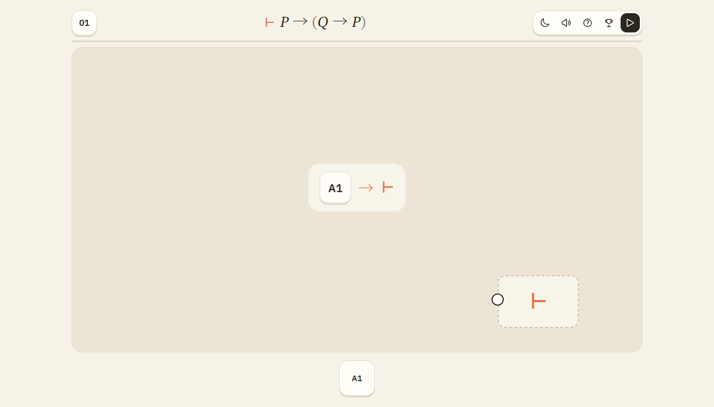
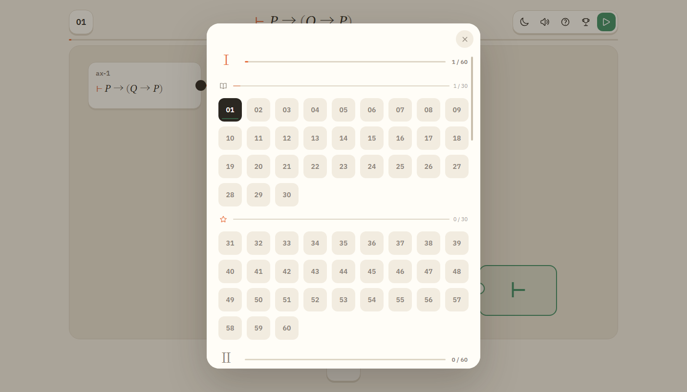
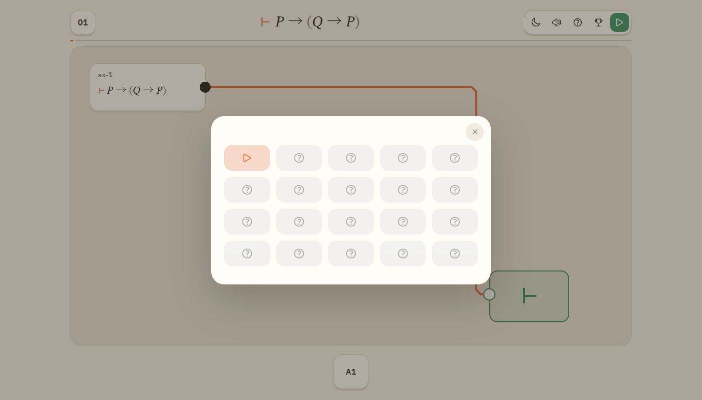
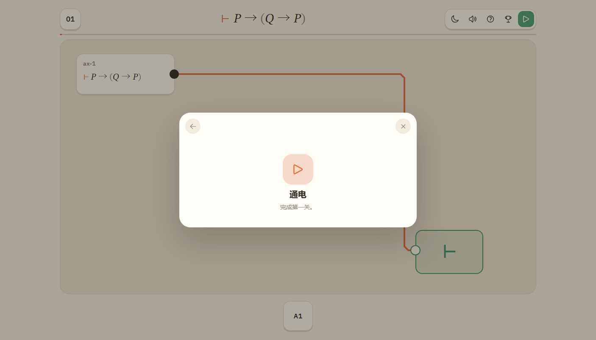
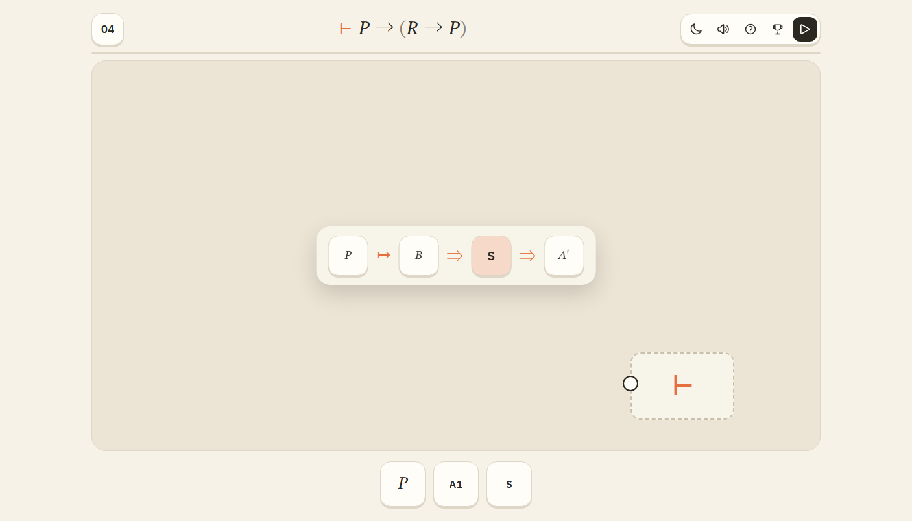
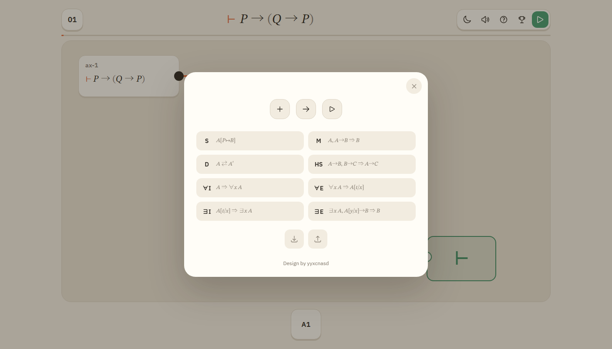

<div align="center">
  
  <h1>公理板</h1>
  <p><b>把形式证明，接成一块板。</b></p>
  <p>一款基于 Metamath <code>set.mm</code> 的接线证明游戏。<br>每关只有一块空板、几枚公理或规则模块，以及一个要证的断言。</p>

  <p>
    <a href="https://yyxcnasd.github.io/RusselL/"></a>
    
    
    
  </p>

  <p>
    <a href="#怎么玩">怎么玩</a> ·
    <a href="#关卡">关卡</a> ·
    <a href="#规则来源">规则来源</a> ·
    <a href="#成就存档与进度">成就与存档</a> ·
    <a href="#本地运行">本地运行</a> ·
    <a href="#开发">开发</a>
  </p>
</div>

<p align="center">
  
</p>

## 怎么玩

1. **拿模块**：从下栏把模块拖到板上；也可以点一下，让模块粘在鼠标上，再点画布放下。下栏里 `*07` 表示已经通过的第 7 关。
2. **接线**：从模块右侧圆点拖到另一个模块左侧圆点；也可以先点输出、再点输入。
3. **校验**：把最终断言接到右侧的 `⊢`，点顶栏最右边的播放键。
4. **修改**：右键删除模块或导线，触屏长按删除；把模块拖回下边栏也能删除。点模块可以改参数（命题变元只有 PQRSTUVWXYZABC 这 14 个）。已接线的输入端可以按住拖走拆线，拖到别的输入端重接，松手在空白处则丢弃。触屏可以双指缩放棋盘，双击空板回到适应视图。

进入关卡时会弹一次规则提示，只画“输入 → 模块 → 输出”；第一次左键操作后自动消失，不显示本关答案。S 代入可以同时接最多 5 组“原子 + 公式”（点 + 加组、− 减组），一次换多个变元。帮助页里还有 S/M/D/HS/∀I/∀E/∃I/∃E 的公式图示，点卡片可以重新看提示。

## 关卡

一共 240 关，四章各 60 关，每章再分成 30 关基础段和 30 关挑战段。

| 章 | 主题 | 基础 | 挑战 |
|:---:| --- |:---:|:---:|
| Ⅰ | 命题演算：`ax-1`–`ax-3` 与早期命题定理 | 30 | 30 |
| Ⅱ | 谓词演算：`ax-4`、`ax-5`、`ax-10`、`ax-11` | 30 | 30 |
| Ⅲ | 等词：`ax-6`–`ax-9`、`ax-12`、`ax-13` | 30 | 30 |
| Ⅳ | 集合论：ZFC 七条公理 | 30 | 30 |

- **基础段**顺序解锁：先用档案里的难证定理/公理做代入、全称闭包与定义推演（不能把定理本身直接接目标），再接触更多档案引理和定义置换；打完本章基础段，下一章基础段才解锁。
- **挑战段**在基础段完成后开放，不挡下一章，内容以分离、双代入、闭包后例化等组合操作为主。
- 命题章第 4–6 关是 S 代入、M 分离、D 定义置换教程；谓词章第 11–12 关是 ∀I、∀E 教程。

<p align="center">
  
</p>

## 规则来源

内容来自 [Metamath Proof Explorer](https://us.metamath.org/mpeuni/mmset.html) 的 `set.mm`：

- 20 条公理，加 4 条定义。
- `df-or`、`df-an`、`df-ex`、`dfbi2` 只是缩写，不能当断言模块接进目标；它们只参与“定义等价”判定和 `replace` 模块。
- 993 条 `set.mm` 条目收进档案模块，用 `archive:<label>` 接入。
- 关卡目标是 `set.mm` 的公式；游戏没有实现完整的 `set.mm` 证明器，也不声称重新证明了这些定理。

细节、DV 条件和数据来源见 [docs/metamath.md](docs/metamath.md)；谓词、等词、集合论部分分别见 [docs/predicate.md](docs/predicate.md)、[docs/equality.md](docs/equality.md)、[docs/set-theory.md](docs/set-theory.md)。

## 成就、存档与进度

- 20 个成就，覆盖基础/挑战章节、规则使用、短证明、干净三关和几个指定关卡的长度指标。未解锁显示问号且不能点开；已解锁可以展开条件说明。
- 帮助页底部有“保存 / 加载”，存档是 JSON 文件，包含进度、成就、每关最佳长度和通关电路。重进已通关关卡会看到保存的电路。
- 每关记录通关电路用了几个模块。选关格底部的绿条表示你离参考电路有多近；胜利面板显示本次长度和参考长度。
- 下栏已通过的关卡显示为 `*07`（星号 + 关卡编号）。

| 成就 | 成就详情 |
| --- | --- |
|  |  |

<details>
<summary>界面图例</summary>

| 规则提示 | 帮助页 |
| --- | --- |
|  |  |

</details>

## 本地运行

直接打开 `index.html` 就能玩。也可以起一个静态服务器：

```bash
python -m http.server 8000
```

然后访问 `http://localhost:8000`。

## 开发

```bash
npm test              # 43 项单测（逻辑/成就/存档/走线/关卡目录）+ 240 关参考电路
npm run test:ui       # Edge headless 真浏览器回归（放置、连线、通关、暗色、移动端）
npm run test:acceptance  # 构建 dist/ 后做独立验收（含 dist 产物 file:// 冒烟）
npm run build:toy     # 只生成 bilibili Toy / Pages 用的 dist/
```

模块划分、加载顺序与数据流见 [docs/ARCHITECTURE.md](docs/ARCHITECTURE.md)；颜色/字体/形状/组件状态与文案记法见 [docs/DESIGN.md](docs/DESIGN.md)。

浏览器测试需要本机 Edge：

```bash
node tests/simple-smoke.js
node tests/simple-ui.js
```

关卡与档案是生成的，不要手改 `src/levels-generated.js` 和 `src/archive.js`。改生成器后重新跑：

```bash
node scripts/gen-levels.js
```

### 主要文件

| 文件 | 作用 |
| --- | --- |
| `src/logic.js` | 公式 AST、解析、展开、代入、置换、分离（纯函数） |
| `src/engine.js` | 模块元数据与电路求值器 |
| `src/route.js` | 纯几何走线（A*、正交化、45° 倒角），无 DOM |
| `src/board.js` | 底板编辑器：缩放平移、节点/导线交互、渲染 |
| `src/main.js` | 应用状态、存档、关卡流程、调色板拖放与全局事件 |
| `src/ui.js` | DOM 基础件、公式显示、toast、面板与焦点管理 |
| `src/screens.js` | 选关、帮助、成就、通关面板 |
| `src/catalog.js` | 章节分组、解锁链、调色板条目（纯函数） |
| `src/coach.js` | 规则提示窗 |
| `src/audio.js` | 背景音乐与音效 |
| `src/achievements.js` | 成就定义与条件判定 |
| `src/save.js` | 存档结构、校验与本地读写 |
| `src/library.js` | `set.mm` 公理、定义、调色板与章节元数据 |
| `src/archive.js` | `set.mm` 档案模块（生成） |
| `src/levels.js` | 四章手工关与教程关 |
| `src/levels-generated.js` | 生成关卡（生成） |
| `scripts/gen-levels.js` | 关卡/档案生成器 |
| `docs/` | 数学、数据、架构与设计说明 |
| `research/` | `set.mm` 提取数据和开发笔记 |

页面是纯静态的，没有后端，也不在运行时请求网络。GitHub Pages 在每次推送 `main` 时运行 `node scripts/build-toy.js`，上传 `dist/`；bilibili Toy 也使用压缩后的 `dist/` 内容。

界面和下栏用 IBM Plex Sans，公式用 STIX Two Text；图标来自 Heroicons。

## 致谢

- 背景音乐：YannZ 的 *lvl 3 – the grassland*，CC BY 4.0。完整署名见 [CREDITS.md](CREDITS.md)。
- `set.mm`：Metamath Proof Explorer 数据库，CC0 / public domain。
- 字体：IBM Plex Sans、STIX Two Text，SIL Open Font License。
- 图标：Heroicons，MIT License。
- Design by yyxcnasd。本作不是 Metamath 官方产品。
